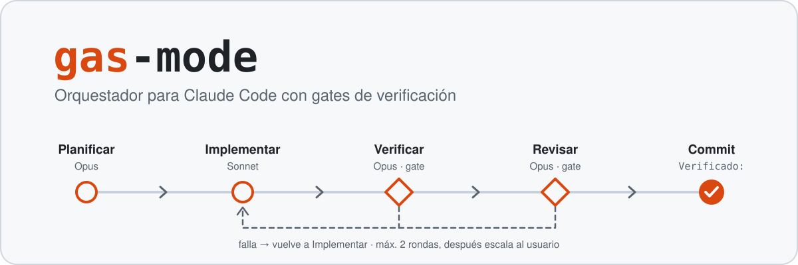

<p align="center">
  <picture>
    <source media="(prefers-color-scheme: dark)" srcset="./assets/banner-dark.svg">
    
  </picture>
</p>

<p align="center">
  <a href="./LICENSE"></a>
  <a href="https://claude.com/claude-code"></a>
  
</p>

# gas-mode

Skill orquestadora para Claude Code. Opus planifica, verifica y revisa; Sonnet implementa en un subagente. Entre cada etapa hay un gate de verificación, y cada commit registra qué se verificó.

```text
/gas-mode:gas-mode el job diario de ventas duplica filas cuando se reintenta
```

## Por qué

Un agente que implementa y se autoevalúa en el mismo contexto tiende a:

- dar por terminado un cambio que compila pero nunca se ejecutó;
- parchear el síntoma (guard, retry, `try/except` que traga el error) en lugar de la causa;
- relajar un test o agregar un `ignore` para que el check pase;
- sumar abstracciones que el problema no necesita.

`gas-mode` separa roles para que quien implementa no sea quien aprueba, y exige evidencia de ejecución antes de cada commit.

## Cuándo usarlo

`gas-mode` está pensado para tareas medianas o largas: features completas, bugs que requieren investigar la causa, refactors, cambios en pipelines y diagnósticos de deploy. En esos casos, el costo de planificar, delegar y verificar se compensa con menos retrabajo.

Para cambios chicos (un typo, un valor de config, un ajuste de pocas líneas), no uses el comando. Pedile el cambio a Claude Code directamente.

## Flujo

| Etapa | Rol | Output |
|---|---|---|
| Clasificar | Opus | Objetivo, cambio mínimo y playbook. |
| Planificar | Opus | Plan en `Docs/`: tareas atómicas, firmas y criterio de verificación por tarea. |
| Implementar | Sonnet | Diff según el plan. Sin permiso para modificar checks existentes. |
| Verificar | Opus | Typecheck, lint, tests y ejecución real (Playwright, queries, `curl` al servicio, harness de eval). |
| Revisar | Opus | Diff contra plan y principios. Revisión adversarial en cambios de riesgo. |
| Commit | Opus | Commit con línea `Verificado:`. Push solo con confirmación. |

Lazo de corrección: hasta 2 iteraciones de Sonnet; a la tercera falla se detiene y reporta el diagnóstico. Opus solo edita código en cambios triviales (un archivo, ~10 líneas, sin lógica nueva).

## Reglas

- **Causa raíz.** Un guard, retry o error tragado no cuenta como fix si el estado que maneja no es legítimo. Dos fixes fallidos con la misma premisa obligan a testear la premisa.
- **Checks inmutables.** El diff no puede modificar ni debilitar tests existentes, config de lint o tipos, la skill `verify` ni workflows de CI (skip, aserciones más laxas, `any`, `noqa`, `@ts-ignore`). Opus revisa esos archivos por separado.
- **Sin flaky.** Prohibido `skip`, `sleep` o reintentar hasta que pase. Se busca la causa (orden, estado compartido, tiempo, seeds).
- **Evidencia en el commit.** El cuerpo termina con `Verificado: typecheck OK, 42 tests OK, journey checkout OK`, o `Verificado: ninguno`.
- **Correcciones → enforcement.** Cada corrección del usuario se convierte en el mecanismo más fuerte posible (arquitectura > tipos/lint > test > docs), se prueba contra el error original y se registra en `## Reglas impuestas` del CLAUDE.md del proyecto. Lo que requiere permiso (dependencia nueva, cambio de esquema, CI) se propone con el diff exacto.
- **Idempotencia y costo.** Pipelines y jobs deben converger si se re-ejecutan. Queries de BigQuery con `--dry_run` previo y umbral de costo; corridas de LLM con estimación previa.
- **Rama de trabajo.** No se commitea en la rama por defecto. Si la tarea empieza ahí, `gas-mode` propone crear una rama antes de implementar.
- **Reglas de equipo por PR.** Las reglas nuevas que se agregan al CLAUDE.md de un proyecto llegan a la rama por defecto solo a través de un PR.

## Reglas impuestas por hooks

Al invocar `/gas-mode:gas-mode` se activan dos hooks `PreToolUse`. Siguen activos hasta el final de la sesión.

| Hook | Qué hace |
|---|---|
| [`guard-bash.sh`](./scripts/hooks/guard-bash.sh) | Bloquea `merge`, `rebase`, `reset`, `restore`, `clean`, `checkout --`, `commit --amend`, push forzado, commits en la rama por defecto, escrituras en BigQuery (`bq mk/load/cp/rm`, DML o DDL sin `--dry_run`) y `dbt run/build/seed/snapshot`. |
| [`guard-checks.sh`](./scripts/hooks/guard-checks.sh) | Pide confirmación antes de editar un check existente: tests, snapshots, configuración de lint o tipos, skill `verify-*` y workflows de CI. Crear tests nuevos no pide confirmación. |

Los hooks necesitan `jq`. Sin `jq` no bloquean y avisan por stderr. Para probarlos:

```bash
bash tests/hooks/run.sh
```

Los hooks no ven ediciones hechas con comandos de shell como `sed`. La revisión de Opus sigue buscando cambios a los checks en el diff.

## Instalación

Requisitos: Claude Code, `git`, `gh`, `jq`, MCP de Playwright. Según el playbook: `bq`, `gcloud`, Node 18+.

Desde la biblioteca de plugins de la organización en claude.ai, o desde GitHub:

```bash
claude plugin marketplace add gasmighty/gas-mode
claude plugin install gas-mode@gas-mode
```

Dentro de una sesión de Claude Code, los mismos comandos son `/plugin marketplace add gasmighty/gas-mode` y `/plugin install gas-mode@gas-mode`.

Para que un repo del equipo sugiera el plugin, agregá esto a su `.claude/settings.json`. Cada persona igual tiene que correr el `install` y aceptar el diálogo de confianza de la carpeta.

```json
{
  "extraKnownMarketplaces": {
    "gas-mode": {
      "source": { "source": "github", "repo": "gasmighty/gas-mode" },
      "autoUpdate": true
    }
  },
  "enabledPlugins": { "gas-mode@gas-mode": true }
}
```

Las actualizaciones automáticas están apagadas por defecto para marketplaces que no son de Anthropic. Se activan con `"autoUpdate": true` o desde `/plugin` → Marketplaces.

### Publicar una versión

1. Subir `version` en [`.claude-plugin/plugin.json`](./.claude-plugin/plugin.json). Sin ese cambio, los usuarios no reciben la versión nueva.
2. Correr `claude plugin validate .` y `bash tests/hooks/run.sh`.
3. Mergear a `main`. Para la biblioteca de la organización, publicar la versión nueva desde claude.ai.

## Uso

```text
/gas-mode:gas-mode el botón "Guardar" queda deshabilitado con el formulario completo
/gas-mode:gas-mode agregá export a CSV en la tabla de resultados
/gas-mode:gas-mode medí si el prompt v3 del clasificador mejora precisión sin subir costo
/gas-mode:gas-mode el build de Cloud Run falla desde ayer
```

Los comandos del plugin llevan el prefijo `gas-mode:`, por ejemplo `/gas-mode:correct`.

`disable-model-invocation: true`: el modelo no lo activa solo. Queda en contexto durante la tarea; invocalo de nuevo para otra tarea, tras `/clear` o en sesión nueva.

<details>
<summary><b>Playbooks</b></summary>
<br>

| Playbook | Alcance |
|---|---|
| [Investigación](./skills/gas-mode/playbooks/investigacion.md) | Solo lectura. Explicación con referencias a código e historial de git. |
| [Bug fix](./skills/gas-mode/playbooks/bug-fix.md) | Repro, causa raíz por descarte, test que falla primero, fix. |
| [Feature](./skills/gas-mode/playbooks/feature.md) | Modelo de datos y firmas primero; boceto de arquitectura si cruza módulos. |
| [Refactor](./skills/gas-mode/playbooks/refactor.md) | Test de caracterización antes de mover estructura; migrar llamadores y borrar la API vieja en el mismo cambio. |
| [Perf](./skills/gas-mode/playbooks/perf.md) | Baseline, una mejora por iteración, misma medición antes y después. |
| [Prototipo](./skills/gas-mode/playbooks/prototipo.md) | Variantes descartables en un scratch dir para resolver una decisión. |
| [Datos](./skills/gas-mode/playbooks/datos.md) | Contrato de grano y clave, `--dry_run`, validación con `SELECT` sin materializar, idempotencia. |
| [IA / Eval](./skills/gas-mode/playbooks/ia-eval.md) | Golden set, harness congelado, juez LLM ciego, costo y latencia p50/p95. |
| [Deploy GCP](./skills/gas-mode/playbooks/deploy-gcp.md) | Diagnóstico read-only en Cloud Build y Cloud Run; IAM solo aditivo; verificación post-deploy. |
| [CI/CD](./skills/gas-mode/playbooks/ci-cd.md) | Minutos facturados por job, checks requeridos, `actionlint`, revisión de seguridad, re-medición. |

</details>

<details>
<summary><b>Skills</b></summary>
<br>

| Skill | Función |
|---|---|
| [`/gas-mode:gas-mode`](./skills/gas-mode/SKILL.md) | Orquestador. Punto de entrada. |
| [`/gas-mode:interrogate`](./skills/interrogate/SKILL.md) | Subagentes adversarios intentan romper un diff; solo sobreviven hallazgos reproducidos con un comando. |
| [`/gas-mode:create-verification-skill`](./skills/create-verification-skill/SKILL.md) | Genera `.claude/skills/verify-<app>/` con launch, doctor, recetas por feature y captura de evidencia. |
| [`/gas-mode:correct`](./skills/correct/SKILL.md) | Analiza commits, reverts y reviews; convierte errores recurrentes en checks. |
| [`/gas-mode:reflect`](./skills/reflect/SKILL.md) | Propone ediciones a skills y CLAUDE.md a partir de la sesión. |
| [`/gas-mode:plan-simple`](./commands/plan-simple.md) | Escribe un plan de implementación autosuficiente en `Docs/`. `gas-mode` lo usa antes de delegar. |
| [`gcp-cloud-run-github-deploy`](./skills/gcp-cloud-run-github-deploy/SKILL.md) | Conecta un repo de GitHub a Cloud Run con deploy continuo vía Cloud Build. La usa el playbook Deploy GCP. |
| [`github-actions-cost`](./skills/github-actions-cost/SKILL.md) | Mide minutos facturados y tiempos del CI de GitHub Actions y propone cómo bajarlos. La usa el playbook CI/CD. |
| [`github-actions-hardening`](./skills/github-actions-hardening/SKILL.md) | Revisión de seguridad de workflows de GitHub Actions. La usa el playbook CI/CD. |

`gcp-cloud-run-github-deploy`, `github-actions-cost` y `github-actions-hardening` también se activan solas cuando la tarea lo amerita.

</details>

<details>
<summary><b>Principios</b></summary>
<br>

| Grupo | Principios |
|---|---|
| Base | `laziness-protocol`, `foundational-thinking`, `redesign-from-first-principles`, `attack-the-premise`, `subtract-before-you-add`, `minimize-reader-load`, `exhaust-the-design-space` |
| Arquitectura | `model-the-domain`, `boundary-discipline`, `type-system-discipline`, `migrate-callers-then-delete-legacy-apis`, `separate-before-serializing-shared-state`, `make-operations-idempotent` |
| Verificación | `prove-it-works`, `fix-root-causes`, `sequence-verifiable-units`, `test-behavior-not-implementation`, `explain-the-number` |
| Delegación | `guard-the-context-window` |
| Meta | `proponer-determinismo` |

Un archivo por principio en [`principles/`](./skills/gas-mode/principles/). Se leen bajo demanda y la respuesta final cita los que cambiaron una decisión.

</details>

## Permisos

| Sin confirmación | Con confirmación | Nunca |
|---|---|---|
| Lectura, tests, typecheck, lint, build | `git push` | `merge`, `rebase`, `push --force` |
| Plan y subagentes Sonnet | Slack, Jira, mail, comentarios en PRs | `reset`, `restore`, `clean` |
| Playwright | Dependencias nuevas, recursos de cloud | Escrituras en bases de datos |
| `git commit` tras verificar, fuera de la rama por defecto | Costo sobre umbral | |
| | Crear la rama de trabajo | |

El CLAUDE.md del usuario tiene precedencia. Umbrales y permisos se configuran en [`SKILL.md`](./skills/gas-mode/SKILL.md).

## Créditos y licencia

Basado en [pstack](https://github.com/cursor/plugins/tree/main/pstack), de Lauren Tan, y en el artículo [How the Claude Code team thinks about verification](https://claude.dev/blog/how-the-claude-code-team-thinks-about-verification/).

`github-actions-hardening` proviene de [github/awesome-copilot](https://github.com/github/awesome-copilot) (MIT, ver [`LICENSE`](./skills/github-actions-hardening/LICENSE) en su carpeta).

## Evals

`evals/` tiene casos de [`claude plugin eval`](https://code.claude.com/docs/en/plugin-evals.md) que comparan el resultado con y sin el plugin: no ejecutar rebase, no modificar el test existente y no commitear en la rama por defecto. Cada corrida es una sesión completa de Claude Code y consume la cuota de tu cuenta.

```bash
claude plugin eval . --scaffold --allow-tools Bash Edit Write --max-cost-usd 10 --no-publish
```

MIT. Ver [`LICENSE`](./LICENSE).
